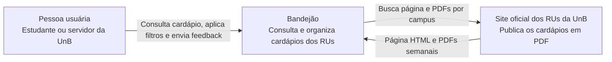
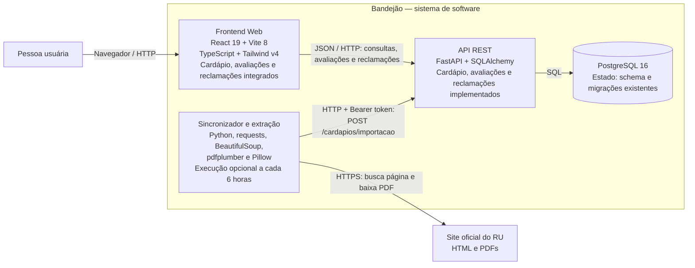
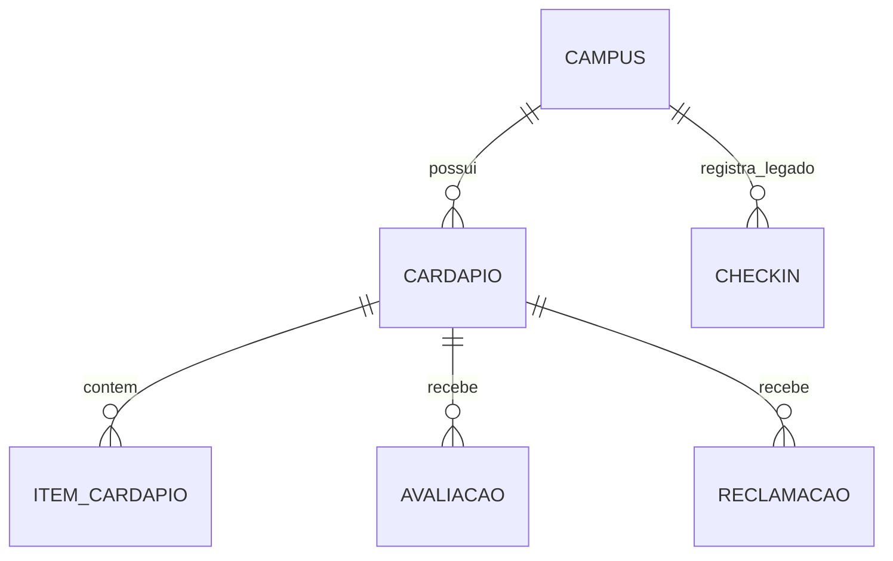

# Documento de Arquitetura — Bandejão

**Projeto:** Bandejão — Cardápio e Fila dos RUs da UnB

**Escopo:** arquitetura da Release 1 e direção da Release 2

**Estado do código consultado:** 27/10/2026 (após o PR 72; publicação integrada pendente)

## 1. Propósito e estado

Este documento apresenta a arquitetura do Bandejão nos níveis de **Contexto** e **Containers** do modelo C4, o modelo de dados existente e os fluxos principais. Os diagramas distinguem a arquitetura pretendida do estado implementado: backend, banco e extração já têm código; a interface React/TypeScript/Tailwind consulta campi, cardápios e avaliações pela API. Filtros locais usam os marcadores dos itens. Reclamações possuem modelo, migração, envio pela tela e leitura interna protegida por token; planejamento e lotação permanecem demonstrações.

O Bandejão centraliza os cardápios publicados em PDF pelos Restaurantes Universitários da UnB. A Release 1 prevê consulta do cardápio por campus, filtros alimentares, avaliações e reclamações. O planejamento semanal e a estimativa de movimento pertencem à Release 2.

## 2. C4 — Diagrama de Contexto

A pessoa usuária consulta o Bandejão. O sistema também depende do site oficial do RU para descobrir e baixar os PDFs semanais. Não há API oficial de cardápios.

## 3. C4 — Diagrama de Containers

O container de extração executa como serviço opcional do Docker Compose. O perfil `sincronizacao` aguarda a API ficar saudável, executa uma sincronização ao iniciar e repete a cada seis horas enquanto o host estiver ativo.

### Responsabilidade e estado de cada container

| Container | Responsabilidade | Implementação observada |
|---|---|---|
| Frontend Web | Consultar cardápios e avaliações; enviar avaliações e reclamações | React 19, Vite 8, TypeScript e Tailwind v4. Consulta campi, cardápios e o histórico da refeição; envia nota e comentário com identidade anônima. Filtros locais usam os marcadores retornados. A tela envia reclamações à API, sem listagem pública ou encaminhamento automático ao RU. Planejamento e lotação seguem demonstrativos. |
| API REST | Validar importações, consultar cardápios e persistir avaliações e reclamações | FastAPI e SQLAlchemy; rotas de campus, cardápio/importação, avaliação e reclamação existentes. CORS permite origens configuradas em `CORS_ORIGINS`. Planejamento ainda não existe. |
| PostgreSQL | Persistir campi, cardápios, itens, avaliações, reclamações e check-ins legados | PostgreSQL 16 no Docker Compose; schema gerenciado pelo Alembic. |
| Processo de extração | Encontrar PDFs, extrair e normalizar dados e enviá-los à API | Pacote Python separado e serviço opcional `sincronizador`; roda uma vez ao iniciar e repete a cada seis horas, sem sobreposição. Os cinco PDFs consultados em 27/10/2026 têm regressão offline; ver [evidência da sincronização](evidencias/sincronizacao-issue-54.md) e [validação anterior](validacao-extracao-pdfs.md). Formatos futuros precisam de nova conferência. |

## 4. Fluxos principais

### 4.1 Importação de cardápio

1. O processo de extração solicita a página oficial do RU e encontra links de PDF por campus e período.
2. Baixa cada PDF e extrai datas, refeições, categorias, pratos e informação de dieta. A identificação de alérgenos compara os ícones das células com a legenda visual do PDF. Nos arquivos validados em 30/09/2026, a legenda não apresenta símbolo separado para frutos do mar; essa informação permanece indisponível.
3. Converte o resultado em um payload normalizado e envia `POST /cardapios/importacao`, autenticado pelo segredo `IMPORTACAO_TOKEN` no cabeçalho Bearer.
4. A API valida primeiro o token e depois campos, enums e alérgenos; requisição não autorizada não grava dados.
5. A chave lógica de uma refeição é `(campus, data, tipo_refeicao)`. Reimportar essa chave substitui os itens anteriores, atualiza a URL de origem e preserva o registro do cardápio, suas avaliações e reclamações.
6. Na mesma transação, a API grava no campus o instante e a URL da fonte da importação bem-sucedida. Falhas anteriores à confirmação preservam o par registrado anteriormente.

A rotina isola falhas por campus durante o processamento. A disponibilidade e a qualidade do cardápio dependem da publicação do RU e da execução bem-sucedida da extração. Sem segredo configurado, a API recusa importações. O token protege a escrita administrativa, mas não substitui HTTPS, rotação de segredo ou isolamento de rede em uma implantação pública.

### 4.2 Consulta e feedback

O frontend consulta `GET /campi/` e `GET /cardapios/`, enviando o campus cadastrado e o intervalo da semana escolhida. A apresentação começa na semana atual (domingo a sábado) e permite outra semana; a refeição é selecionada entre os resultados carregados. A URL é configurável por `VITE_API_BASE_URL`; a API habilita CORS para as origens em `CORS_ORIGINS`. Os filtros aplicam D02: ovolactovegetariano inclui vegetariano estrito, enquanto as demais classes são exatas. As exclusões usam somente os marcadores publicados e a tela esclarece que ausência de marcação não significa ingrediente ausente. A tela apresenta o instante da última importação bem-sucedida do campus no fuso de Brasília junto à URL da respectiva fonte. A integração completa de D01 na apresentação permanece pendente. Lista vazia não indica fechamento do RU.

As rotas para registrar e consultar avaliações existem em `/cardapios/{cardapio_id}/avaliacoes`. A interface envia nota e comentário com `X-Identidade` e consulta o histórico pelo ID da refeição. A listagem permanece disponível após o prazo, retorna somente os registros daquela refeição e vem ordenada do mais recente ao mais antigo. Reclamações separadas das notas possuem modelo, migração e endpoints; a tela envia os registros à API com identidade anônima e apresenta confirmação ou erro, sem listagem pública.

### 4.3 Planejamento e previsão — Release 2

O código ainda contém o modelo/tabela de check-ins, que representam uma abordagem antiga, mas suas rotas HTTP foram retiradas. O requisito vigente substitui check-in por planejamento antecipado. A decisão D05 limita a estimativa à quantidade de intenções por campus, data e refeição, com mínimo de 10; não serão inferidos horário de chegada nem tempo de espera.

## 5. Modelo de dados atual

O diagrama representa as tabelas/modelos existentes, não as funcionalidades futuras. `CheckIn` está marcado como legado e deve ser substituído conforme a Release 2 for projetada.

| Entidade | Dados principais | Relações e regras |
|---|---|---|
| `Campus` | Identificador, nome único, instante e URL da última importação bem-sucedida | Um campus possui vários cardápios e check-ins legados; os metadados só mudam quando a transação de importação é confirmada. |
| `Cardapio` | Campus, data, tipo de refeição e URL do PDF | Único por campus + data + tipo de refeição; possui itens, avaliações e reclamações. |
| `ItemCardapio` | Categoria, tipo de dieta, nome e indicadores booleanos de alérgenos | Pertence a um cardápio; os itens são substituídos ao reimportar a mesma refeição. |
| `Avaliacao` | Identidade do navegador, nota de 1 a 5, comentário opcional e data de criação | Pertence a um cardápio; o banco impõe o intervalo da nota e uma avaliação por identidade/refeição. |
| `Reclamacao` | Cardápio, identidade do navegador, categoria, descrição de até 1.000 caracteres e data de criação | Pertence a um cardápio; envio independente da nota e leitura interna protegida por token da equipe. |
| `CheckIn` | Campus e data/hora de criação | Pertence a um campus; entidade da abordagem anterior, sem horário previsto de chegada. |

Não há uma entidade separada `Refeicao`: no schema atual, `Cardapio` representa uma refeição de um campus numa data. Planejamento semanal ainda é uma entidade futura e não está no diagrama do schema existente.

## 6. Fontes e disponibilidade dos dados

| Dado | Fonte | Frequência/atualização | Disponibilidade e risco |
|---|---|---|---|
| Cardápio | PDFs ligados pela página oficial `https://ru.unb.br/cardapio-refeitorio/` | A publicação é semanal; a extração busca os links quando é executada. | Não há API oficial. Links, tabelas e ícones podem mudar sem aviso; o cardápio também pode ser alterado pelo RU. |
| Campus | Nome extraído do arquivo ou já cadastrado no banco | Criado durante importação quando ainda não existe; guarda o último sucesso e a fonte | A identificação depende dos nomes/formatos usados nos links dos PDFs. |
| Avaliação | Envio da pessoa usuária pela interface, com identidade anônima | Registrada ou atualizada no envio | A interface lista o histórico persistido da refeição escolhida. Não há conta de usuário associada; o código anônimo não aparece nas respostas. |
| Reclamação | Envio pela interface à API, sem listagem pública | Registrada no envio | Há modelo, migração e endpoints integrados à tela. Leitura interna exige token da equipe; o autor recebe confirmação, sem consulta posterior implementada. |
| Planejamento | Previsto para a Release 2 | A definir | Sem persistência implementada. D05 prevê intenções por campus, data e refeição, sem horário de chegada. |

## 7. Tecnologias

| Camada | Tecnologia observada |
|---|---|
| Extração | Python 3.13 no Docker e 3.12 na CI, `requests`, BeautifulSoup, `pdfplumber` e Pillow |
| API | Python 3.12, FastAPI, SQLAlchemy, Pydantic Settings e Alembic |
| Banco de dados | PostgreSQL 16 |
| Frontend | React 19, TypeScript/TSX, Vite 8 e Tailwind CSS v4; cliente HTTP tipado, plugin Tailwind no Vite e checagem de tipos antes do build |
| Ambiente local | Docker Compose com banco, API e frontend; extração periódica no perfil opcional `sincronizacao` |
| CI e publicação | `.github/workflows/ci.yml` executa testes, lint e build quando há alterações da aplicação. `.github/workflows/sast.yml` executa Bandit e CodeQL, obrigatórios no ruleset ativo da `main`. `.github/workflows/docs.yml` valida e publica o MkDocs. A preparação de hospedagem da aplicação está no PR 71, ainda pendente de integração e ativação. |

## 8. Interfaces relevantes

- `GET /health` — verificação básica da API.
- `GET /campi/` e `GET /campi/{id}` — consulta de campi.
- `GET /cardapios/` e `GET /cardapios/{id}` — consulta de cardápios; a listagem aceita filtros.
- `POST /cardapios/importacao` — contrato autenticado por Bearer token entre a extração e a API.
- `GET /cardapios/{id}/avaliacoes/` e `POST /cardapios/{id}/avaliacoes/` — histórico e criação de avaliação.
- `POST /cardapios/{id}/reclamacoes/` — registro de reclamação, com identidade do navegador e janela validada pela API.
- `GET /equipe/reclamacoes/` — leitura interna, protegida pelo token da equipe.
- As rotas HTTP de check-in legado foram retiradas na Sprint 03; modelo e tabela permanecem para migração futura.

A documentação OpenAPI fica em `/docs` quando a API está em execução. O contrato detalhado do payload de importação está em `docs/handoff_banco_e_importacao.md`.

## 9. Ambiente local

O `docker-compose.yml` define PostgreSQL, backend e frontend, além do serviço opcional `sincronizador`. O README orienta criar `backend/.env`, definir `IMPORTACAO_TOKEN`, subir os serviços e aplicar as migrações. Só depois se ativa o perfil de sincronização. Os endereços locais documentados são API `http://localhost:8000`, OpenAPI `http://localhost:8000/docs` e frontend `http://localhost:5173`.

A extração também pode ser iniciada fora do Docker com `python -m extracao.sincronizar --backend-url http://localhost:8000`, desde que o mesmo `IMPORTACAO_TOKEN` esteja no ambiente do processo. O seed é apenas para desenvolvimento: ele remove o campus chamado “Gama” e dependências antes de recriar os dados de exemplo, portanto não deve ser usado em uma base com dados reais a preservar.

## 10. Restrições e decisões arquiteturais

- O extrator está separado da API porque o formato de origem é externo e frágil; ele conversa com o backend pelo contrato de importação, sem compartilhar tabelas ou sessão de banco.
- O backend atual é uma API única com persistência relacional; o projeto não tem necessidade observada de dividir serviços em microserviços.
- O Docker Compose descreve apenas o ambiente local. O perfil periódico depende de um host continuamente ligado; execução confiável em produção ainda exige ambiente de deploy e monitoramento.
- A importação exige token. Uma implantação pública também deve usar HTTPS, limitar a exposição da rota e definir rotação do segredo.
- Para Release 2, o dado coletado deve ter granularidade compatível com o que a previsão promete. Intenções por refeição não determinam um horário.

---

*Documento revisado em 27/10/2026 para refletir o schema e os componentes da `main`. Integração e testes não comprovam publicação nem aceite operacional. Requisitos futuros estão identificados como planejados.*

## Situação de publicação em 27/10/2026

A preparação de HTTPS está no PR 71 da equipe; o ambiente proposto ainda não responde como aplicação integrada. URLs verificadas retornaram 404 e não há acesso Render nesta entrega. Consulte [verificação de publicação](verificacao-publicacao.md) para protocolo, evidências e ativação. A sincronização da issue 54 foi corrigida e validada com cinco PDFs reais e reimportação isolada; sua execução contínua na hospedagem ainda precisa ser observada. O aviso de [privacidade](privacidade.md) cobre a identidade do navegador e os envios persistidos.
